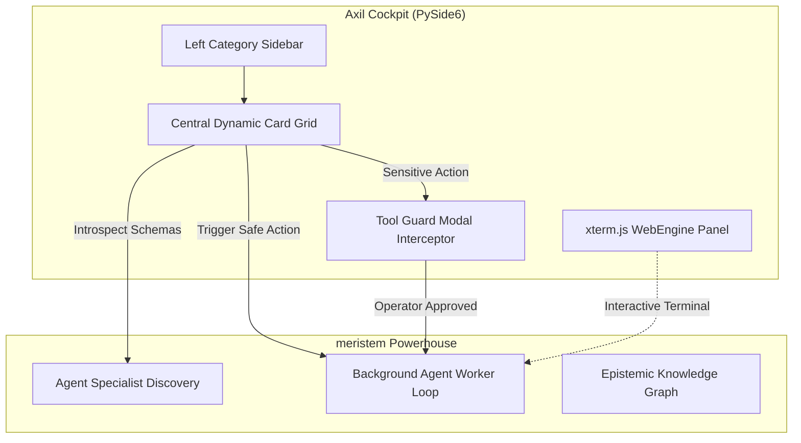

# Axil

<p align="center">
  
</p>

<p align="center">
  <b>The desktop cockpit for Arbora.</b><br>
  <sub>A unified, visual control deck over the Arbora multi-agent ecosystem.</sub>
</p>

[](https://github.com/Knuckles-Team/axil/stargazers)
[](https://github.com/Knuckles-Team/axil/forks)
[](https://github.com/Knuckles-Team/axil/graphs/contributors)
[](LICENSE)
[](https://github.com/Knuckles-Team/axil/commits/main)
[](https://github.com/Knuckles-Team/axil/issues)
[](https://github.com/Knuckles-Team/axil)
[](https://pypi.org/project/axil/)
[](https://pypi.org/project/axil/)
[](https://pypi.org/project/axil/)
[](https://github.com/Knuckles-Team/axil/actions/workflows/release.yml)
[](https://knuckles-team.github.io/axil/)

<p align="center">
  <a href="https://knuckles-team.github.io/axil/">Documentation</a> ·
  <a href="https://knuckles-team.github.io/axil/overview/">Architecture</a> ·
  <a href="https://knuckles-team.github.io/axil/concepts/">Concepts</a>
</p>

*Version: 5.2.2*

## Overview

The repository is `axil`; the package, imports and executable remain `axil`.
Existing icon assets and screenshot provenance are retained.

Axil is a desktop GUI application and visual control deck built on top of
[Arbora](https://knuckles-team.github.io/arbora/) and its `meristem`
control plane. It integrates every specialist agent and MCP package in the fleet
into a single-pane-of-glass user interface, offering 1-click execution, embedded
hybrid terminals, zero-nesting visual layouts, and a zero-trust hardware
protection layer.

Axil provides a centralized graphical cockpit designed to eliminate tedious click-through fatigue. It maps specialist agent parameter schemas directly to custom QSS-themed form widgets on the fly.

Operators can trigger actions, monitor running terminal inputs via the embedded `tuig`, and secure dangerous CLI calls using the Zero-Trust Tool-Guard interceptor.

## Key Capabilities

- Dynamic, schema-driven control panels for every specialist agent and MCP package in the fleet.
- An embedded hybrid terminal (`xterm.js`) for interactive, in-cockpit sessions.
- A zero-trust Tool-Guard that intercepts and confirms sensitive mutations before execution.
- Ask-Data (NL→Query), engine metrics/PromQL, and federated search over the Arbora gateway.
- A fleet supervisory cockpit: worker topology and the ActionPolicy approval inbox.

## Table of Contents
1. [Overview](#overview)
2. [Key Capabilities](#key-capabilities)
3. [Features](#-features)
4. [Architecture](#-architecture)
5. [Installation](#-installation)
6. [Usage](#-usage)
7. [Packaging & Executables](#-packaging--executables)
8. [Documentation References](#-documentation-references)
9. [License](#-license)

---

## ✨ Features

* **Zero-Nesting Dynamic UI**: Navigation categorized into flat category menus (Dashboard, Infra, Media, Productivity, Research).
* **Dynamic Card Schema Grid**: PySide6 widgets are built automatically from specialist agent tool specifications.
* **Embedded Hybrid Terminal**: Hosts local `xterm.js` to run interactive terminal loops directly in the cockpit.
* **Zero-Trust Security Tool Guard**: Prompts native authorization dialogs to review arguments before executing dangerous mutations.
* **Runnable Background Workers**: Utilizes thread pools (`QThreadPool`) to prevent GUI freezes during execution loops.
* **Visual Trading Dashboard**: Snappy native C++ charting engine (`PySide6.QtCharts`) with OHLCV candlestick/line toggles, strategy indicator overlay crossovers (MACD/RSI), orderbook bids/asks depth volumes, and thread-safe crypto news feeds.
* **Ask Data (NL→Query)**: Ask the Knowledge Graph a question in plain English; the engine generates an auditable read-only query (UQL/Cypher/SQL/SPARQL), runs it, and synthesizes an answer with citations — over the gateway `/api/graph/ask-data` and `/api/graph/nl-query` routes.
* **Engine Metrics & Status**: Query engine observability with PromQL (`/api/graph/promql`) and watch the shared content-addressed KV-cache occupancy (`/api/graph/kvcache`).
* **Federated Search**: Fan one query across every registered external graph and rank the merged results (`/api/graph/federated-search`).


---

## 🏛️ Architecture
Axil is engineered as a lightweight PySide6 GUI client wrapper around the `meristem` logic engine.



Detailed architectural diagrams and component breakdowns are located in the [Documentation Overview](docs/overview.md).

---

## 🛠️ Installation

### 1. Modern Virtual Environment (via uv)
Create a virtual environment and sync standard requirements:
```bash
# Setup virtual environment
uv venv

# Sync requirements
uv pip sync requirements.txt
```

### 2. Standard pip
Install standard stable packages:
```bash
pip install axil
```

Install with all ecosystem plugins:
```bash
pip install axil[all]
```

---

## 🌍 Environment Variables

Axil can be configured using environment variables or a `.env` file in the project root:

| Variable | Description | Default / Example |
|----------|-------------|-------------------|
| `QT_QPA_PLATFORM` | Headless Qt Platform (set to `offscreen` for CI/CD or Docker) | `offscreen` |
| `LANGFUSE_PUBLIC_KEY` | Langfuse Observability Public Key | `pk-lf-...` |
| `LANGFUSE_SECRET_KEY` | Langfuse Observability Secret Key | `sk-lf-...` |
| `LANGFUSE_HOST` | Langfuse Host URL | `https://cloud.langfuse.com` |
| `LOGFIRE_TOKEN` | Pydantic Logfire Telemetry Token | |
| `TERM` | Terminal type for the embedded terminal emulator | `xterm-256color` |
| `_MEIPASS` / `_MEIPASS2` | PyInstaller temp directories for bundled app context | *(Used internally)* |

---

## 🚀 Usage

Launch the desktop cockpit:
```bash
uv run axil
```

To run in headless or virtual Linux environments (CI/CD):
```bash
QT_QPA_PLATFORM=offscreen uv run axil
```

---

## 📦 Packaging & Executables

### PyInstaller Compiling
Compiling Axil as a single standalone executable:
```powershell
python -m pip install --upgrade pyinstaller
git clone https://github.com/Knuckles-Team/axil.git axil
cd axil
python -m venv .venv
./.venv/Scripts/activate
python -m pip install -r ./requirements.txt
python -m pip install -r ./build-requirements.txt
python -m pip install --upgrade pandas scipy numpy pydantic
pyinstaller --name axil `
  --log-level DEBUG `
  --onefile --windowed `
  --paths "./axil" `
  --icon='./axil/img/axil.ico' `
  --recursive-copy-metadata=opentelemetry_api `
  --recursive-copy-metadata=opentelemetry_sdk `
  --recursive-copy-metadata=opentelemetry_exporter_otlp_proto_grpc `
  --exclude-module pygame `
  --exclude-module tkinter `
   ./axil/axil.py
```

### Windows Setup Installer
Generate a Windows MSI setup package:
```bash
iscc "./packaging/windows/setup.iss"
```

---

## 📚 Documentation References
For deep architectural guidelines and code documentation, explore:
* [docs/index.md](docs/index.md) — Documentation Entrypoint & Quickstart.
* [docs/overview.md](docs/overview.md) — Detailed Architecture & Security Guardrails.
* [docs/concepts.md](docs/concepts.md) — Concept Registries (`CONCEPT:GB-GBOT.cockpit.gbot` through `8.0`).

Start at the [Axil documentation](https://knuckles-team.github.io/axil/) for the
hosted, always-current version of the same material.

---

## Contributing

See [AGENTS.md](AGENTS.md) for contribution and validation guidance.

## 📄 License
This project is licensed under the MIT License - see the [LICENSE](LICENSE) file for details.
